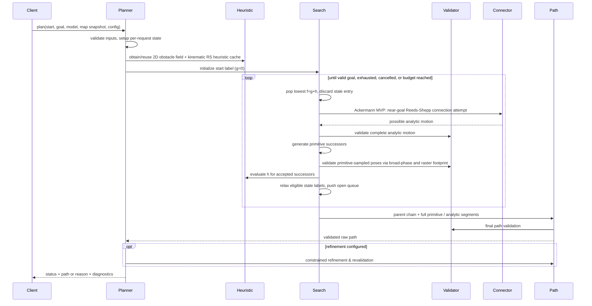

# Algorithms and invariants — draft v0.1

These are **behavioral specifications**, not proof of completeness, optimality, or hard real-time guarantees. The baseline deliberately retains **one continuous node per model-specific discretized key** (ADR-0013); exact tie-breaking, numeric precision and sampling/certification require review.

## Hybrid A* request flow



## Core search pseudocode

```text
validate request/map/model/start/goal and ensure the same planning frame
bind one immutable map revision and explicit per-request occupancy policy
# default: unknown Occupied; known maxTraversableOccupancy=0
# in Reject mode, validate the ENTIRE supplied map for -1 before search
initialize or fetch model-specific primitive catalog and compatible heuristic cache
check full start state validity/collision and validate goal-region specification
# a nominal goal-center pose can collide while valid end configurations exist within tolerance
insert start node: continuous state, model-specific discrete key, g=0, parent=none
while open not empty:
    if cancellation or budget reached: return explicit failure
    pop best f; skip stale labels
    if goal condition met: record valid candidate / apply termination policy
    if Ackermann and xyDistance(current continuous pose, goal pose) <= goalConnectionRadius:
        try OMPL-backed Reeds-Shepp path from current state to exact requested goal pose
        sample every segment at <=0.10 m traveled length incl cusps/endpoints
        if model/goal-valid and all sampled footprints map-collision-free:
            evaluate true connector length and weighted cost incl all gear switches
            if length/cost quality guards pass (with configured close-maneuver exceptions):
                reconstruct and revalidate full prefix + connector; return feasible-first Success
        # any connector failure -> ordinary primitive expansion continues
    for each primitive candidate from current model state:
        instantiate compatible cached local template or generate state-dependent motion
        evaluate complete motion/end state from RK4-built primitive and control law
        at each stored primitive pose: query conservative hull collision mask
        if flagged: rasterize transformed footprint edges
        if flagged and collision.checkFootprintInterior: also scan enclosed cells
        # default: no separate fixed collision sampling; adaptive extra samples only if enabled
        reject invalid controls, infeasible states, or sampled-motion collisions
        compute successor key (Ackermann includes incoming forward/reverse gear) and nonnegative edge cost
        relax the one retained continuous node per model-specific discrete key
        # Ackermann key includes incoming gear to account for switch penalty; no extra mid-primitive nodes
        compute h=max(kinematic RS, obstacle-grid 2D distance) in declared search mode
        enqueue eligible successor
    terminate only when stopping rule justifies chosen quality guarantee
reconstruct exact state/control segments from stable parent records
validate reconstructed trajectory against request's map/model
optionally refine, accepting only separately validated result
return status, path and diagnostics
```

### Default goal acceptance (OQ-008, ADR-0016)

Accept only validated **continuous** candidate endpoints satisfying both `hypot(x-x_goal,y-y_goal) <= 0.25 m` and `abs(wrap(yaw-yaw_goal)) <= 10°`, with independently configurable thresholds (including zero). A caller may add model-specific state constraints; all unspecified joint/configuration variables remain free but must be valid. Do not accept by key alone or snap to the nominal goal center. The objective heuristic must target the **whole goal region**.

### Critical search invariants

- `g` represents the cost of actual accepted transitions; always nonnegative and finite. In-place rotations have **positive cost** even with zero translation.
- Parent/action records reconstruct the *exact* accepted motion (not straight lines between discretized cell centers).
- **OQ-001 / ADR-0013, Ackermann refinement ADR-0025:** use one retained continuous node per **complete** discretized key; the initial Ackermann key uses 0.25 m XY bins, 10° yaw bins and **incoming forward/reverse mode**. Preserve incoming primitive, parent and `g`. Different continuous arrivals or unindexed control histories can still merge, so lowest-`g` replacement remains approximate and may lose feasible or lower-cost continuations. Multi-label machinery is deferred. Correct stale-entry handling and documented reopening/termination remain necessary.
- A popped node is not automatically globally optimal even with an admissible heuristic, since the quantized key may merge nonequivalent continuous states. Inconsistent/weighted heuristics add separate limitations. Reopening/termination assumptions must be explicit.
- **ADRs 0026–0028:** the first Ackermann MVP **must** try OMPL-backed Reeds–Shepp analytic expansion at selected search nodes whose XY distance to the requested goal is inside a configurable near-goal radius (**proposed 5.0 m fixture/default for review; not yet approved numeric setting**). A connector to the exact target pose is checked over all analytic arc/straight samples (at most 0.10 m spacing per segment, including each cusp), costed with actual forward/reverse lengths and direction switches (**no clearance integral in the MVP**), and subjected to **configurable path-length and weighted-cost safeguards (ADR-0027)**. If accepted, append it to the stable parent path and independently revalidate; feasible-first termination carries no optimality guarantee. A failed connector or colliding nominal goal center must **not** prevent ordinary search from finding a valid endpoint within goal tolerances. Never accept analytic expansion without model/goal/map validity.
- The discretized search may lose reachability at finite resolution; report actual guarantees, not idealized continuous-space completeness.

## Obstacle-aware heuristic

1. Use immutable static grid and a **goal-rooted, nonnegative-weight reverse graph search** (Dijkstra); do not just run point-to-point A*. World/grid conversion uses inverse SE(2) origin transform and X-fastest row-major memory order as specified in [map-coordinates.md](map-coordinates.md).
2. Optionally lazy-expand until the queried cell is **settled**; incomplete frontier values cannot be returned as final distances.
3. Use compact contiguous 2D storage for distances and visited/settled state; permit cache reuse only with matching map identity/revision, frame, **origin position/yaw**, resolution, dimensions, goal region, occupancy/unknown/threshold policy, and algorithm settings. The occupancy policy is **request-level**, not a mutation of `MapSnapshot`; default is unknown `Occupied` and known occupancy maximum `0` for frontier exploration. A new sensor-produced snapshot does not alter a running request's map. **Accepted ADR-0019:** on-demand rebuilding for cache misses, bounded retention, no incremental map-field repair in the baseline; old revisions stay valid for already running requests ([decision](../adr/0019-live-map-snapshot-cache-and-reject.md)).
4. **ADRs 0015 and 0027:** the initial performance-oriented Ackermann search implements **both** a nonholonomic obstacle-free Reeds–Shepp estimate and a holonomic obstacle-aware 2D reverse-Dijkstra field, combined as `h=max(h_RS,h_grid)`. Precompute/cache goal-rooted Dijkstra per matching map+goal+policy, and optionally bounded relative-pose RS distance lookup. **Do not label this combination admissible automatically**: exact-pose RS may overestimate distance to a goal tolerance *region*, and discrete grid distance can overestimate continuous distances. Offer a strict certified mode using separately proven lower bounds (e.g. Euclidean-to-goal-region), and clearly report the performance mode's unproven optimality properties.
5. **Admissibility caveat:** a grid's 4-/8-connected shortest-path cost is generally an *upper* approximation to shortest unconstrained continuous distance; conservative edge graph definitions/inflation and boundary offsets must be proved safe before claiming an admissible bound. Heuristic mode and guarantee metadata must expose this.
6. Treat unreachable (infinite) heuristic cells carefully: map-level disconnection can prune safely only if the static relaxed map models traversability conservatively; otherwise retain search freedom.

## Kinematic steering and primitive integration

- **Accepted ADR-0023:** the generator uses model-specific admissible controls and RK4 to produce numerical **complete-state motion primitives**. For translating maneuvers integrate accumulated traveled length `s` with `ds/dt = hypot(xdot,ydot)` and terminate at configured length `L` within tolerance, refining the last integration step iteratively if necessary. Use direct duration conversion when speed is known constant and nonzero; stop nontranslating angular/configuration maneuvers on a different extent (ADR-0012). Store ordered complete-state checkpoints for debug/visualization, while keeping a control-law/numerical representation to evaluate states between samples.
- **Accepted first Ackermann numerical defaults (ADR-0025):** six forward/reverse straight/left/right primitives, each 0.50 m of traveled length, generated with nominal RK4 steps 0.05 s at nominal 1 m/s, accepted length error 0.0001 m and 0.10 m stored-sample spacing (six complete-state points). Stored samples are the default collision evaluation points; additional intermediate states are requested only by optional adaptive subdivision.
- **Search reuse:** precompute SE(2)-relative local templates only where full-state evolution is equivariant and internal state/configuration matches. Apply a compatible template at the continuous search-node state to obtain end state and intermediate states without repeated RK4. For state-dependent articulated kinematics, use internal-state-keyed generation/caching or regenerate as necessary. Holonomic/nonholonomic classification metadata never substitutes for model validity checks.
- **OQ-007 / ADRs 0014 and 0023:** the initial Ackermann model uses continuous `(x,y,yaw)` state and straight/constant-curvature left/right (optional intermediate) arcs for forward/reverse motion. The model's controlled differential equation is the source of truth; baseline primitive generation uses **RK4**, with analytically exact arc formulas as correctness oracles and possible later optimized evaluators. Numeric RK4 endpoints are approximations to these mathematical arcs and must meet error tolerances; do not promise exact numerical propagation. Finite steering-rate/continuous steering at arc boundaries is **not** guaranteed by raw geometric propagation and must be checked before asserting it.
- Differential-drive in-place rotations must be modeled and pose-sampled along the angular primitive; no continuous swept-volume guarantee is asserted. Ideal mecanum must also support sideways translation with unchanged yaw and simultaneous translation/rotation without treating yaw as the tangent heading.
- **Near-goal Reeds–Shepp is required for the initial three-state Ackermann MVP** (ADRs 0026–0028), using OMPL behind the steering adapter; its exact straight/arc sections are sampled at **no more than 0.10 m** traveled distance **per section**, always including starts, ends and forward/reverse cusps. Normal RK4 primitive generation remains separate. Other Dubins/connector use is optional and model-compatible; no finite steering-rate or articulation guarantee follows from a Reeds–Shepp result.
- **Accepted initial Ackermann cost defaults (ADR-0025; apply identically to primitive and Reeds–Shepp edges per ADR-0026; Stanford Junior as qualitative reference, not source of numerical weights):** for traveled arc length `L`, use `1.00*L` forward or `1.10*L` reverse, plus `0.50 m` on a **change of travel direction** (no cost for choosing the first direction), plus an **optional future** `0.15 * integral(phi(d_full_footprint(s))) ds` (**disabled and unimplemented in the MVP**), where `phi(d)=max(0,1-d/0.40m)^2`. Apply hard shape/cell collision rejection independently; do **not** compute clearance for MVP edge costs; a low-priority future option may approximate the soft integral at those stored primitive samples. Units are equivalent meters, **not measured execution time**; search steering-change and curvature penalties are zero, leaving them to downstream obstacle-aware refinement. Incoming gear is part of the discrete Ackermann key; one arrival per complete key remains approximate continuous-state pruning (ADR-0013). Use goal-region Euclidean distance as a lower bound; do not assume unproven grid-Dijkstra admissibility (ADR-0015). The required near-goal Reeds–Shepp connector uses the same cost with internal gear changes, plus any incoming-gear-to-first-section change (ADR-0026).
- **MVP EDT (ADR-0029):** compute the nearest-blocked-cell-center Euclidean distance field **only to build the conservative collision-candidate flags**, e.g. `D <= R + sqrt(2)*r` plus map-boundary handling. No 0.40 m clearance-influence mask, per-pose clearance lookup or numerical integral is part of first-implementation edge costs. **Low-priority option:** reuse that field later for actual footprint-boundary clearance samples and a trapezoidal penalty over arc length, applied after collision checks but before successor `g` relaxation; also apply consistently to analytic connectors. This is distinct from the required goal-rooted reverse-Dijkstra heuristic.

## Unknown occupancy and frontier requests (ADR-0017)

- Preserve `-1` as unknown in the map's declared encoding. Each planning request explicitly chooses `Occupied` (default), `Free` or `Reject`, plus `maxTraversableOccupancy` default `0`; for known `c`, traversability iff `c <= max`. Do not hardcode occupancy interpretation into map data.
- `Occupied` blocks sampled-body traversal of unknown cells, allowing an external frontier explorer to target **known-free** endpoints near observation boundaries. `Free` is provisional optimistic planning, not certified free-space validity. `Reject` returns a distinct unknown-occupancy validation error if **any** cell in the **entire supplied map snapshot** is `-1`, **before** search starts; no implicit ROI and no search-order-dependent failure ([ADR-0019](../adr/0019-live-map-snapshot-cache-and-reject.md)).
- Collision, inflation, heuristic and reachability calculations must agree on request-level occupancy interpretation. Map-derived cache fields depend on all relevant effective inputs (map identity/revision, geometry/frame, goal region, threshold, unknown policy, inflation, heuristic options); reuse or compute on demand and retain under a bounded budget. Published revisions are immutable, while mapping/SLAM and replan triggers remain external.

## Primitive-sampled collision checking (ADR-0029)

**Revised MVP (ADR-0029):** At every stored RK4 primitive pose (and every ≤0.10 m Reeds–Shepp section sample), first consult a **preprocessed conservative collision-possibility map** constructed from a hull/envelope of all allowed robot orientations/offsets plus map- and discretization-cell margins. A sound **safe** entry can skip the pose's detailed checks; flagged or missing entries require testing the actual transformed footprint. The all-heading first-MVP envelope may be a disk of radius equal to the **farthest footprint point** from the robot reference point. Mark a map lookup cell flagged when **its entire square can intersect a blocking cell expanded by that envelope** (Minkowski dilation); account for every continuous reference position within that cell, map borders and pinned policy. Rasterize polygon boundaries with a **conservative supercover grid-line iterator** and check blocking cells reached by the raster. **Default:** edges only (`collision.checkFootprintInterior=false`). **Optional:** scanline-fill and check the footprint's interior cells (`true`). The default can **miss an obstacle entirely enclosed** by the polygon; a flagged broad-phase result does not prove a collision and does not repair this false negative. Report a weaker boundary-only sampled coverage separately from full-footprint sampled coverage. This replaces mandatory per-cell polygon/square SAT at runtime. Map snapshot identity/revision, occupancy policy, footprint and quantization bounds are part of the mask's validity assumptions.

For the initial 0.50 m Ackermann primitive, **reuse its six stored samples at 0.10 m traveled arc-length spacing**, start and end included: the checker does **not** maintain a separate collision-only fixed step nor interpolate straight-line poses between search nodes. The intermediate samples are **not new Hybrid A* nodes**. **Only if per-request `adaptiveSubdivision=true` (default `false`)** may the checker evaluate additional intermediate states from the underlying primitive, subdividing between stored samples according to the maximum motion of the furthest affected point of **any** body due to translation, rotation and articulation. Do not infer body-sweep safety from reference-point movement or endpoint differences alone. If enabled adaptive refinement cannot meet its configured criterion within bounded evaluations, report incomplete validation/failure rather than success.

The **rasterized footprint test is performed at sampled states only**; checking those states (with or without adaptive additional poses) does not prove the entire continuously swept path collision-free. Result diagnostics must identify **boundary-only or boundary+interior coverage**, trajectory sample mode/resolution and actual assurance level; **neither mode certifies continuous collision freedom**. Conservative continuous sweeping remains deferred ([ADR-0029](../adr/0029-conservative-orientation-hull-mask-and-raster-footprint-collision.md)). The conservative collision mask does not imply 0.40 m clearance. **No soft clearance penalty is evaluated in the MVP**; a future opt-in scoring mode may derive a separate influence threshold from the same nearest-obstacle EDT (ADR-0029).

## Reconstruction, refinement and output

**Refinement-aware search priority (ADR-0020):** Hybrid A* supplies a feasible geometric starting path and basic maneuver/topology choices; the planned downstream optimizer improves the shape where feasible. Do not inflate search with sophisticated smoothing, dense search nodes within a primitive or expensive effort/steering-objective logic solely to produce a raw shape that refinement will replace. Maintain the model-valid, collision-checked primitive trajectory and reconstructable controls required to validate the initial path. Refinement cannot reliably invent a missed route/homotopy class. When refinement is implemented, assess search changes against final validated path quality, success rate and **combined search+optimization latency**; optimizing raw search quality alone is not the objective.

- Follow stable node parent indices back to start; reverse sequence, append any validated analytic connection, reconstruct intermediate model states.
- Keep exact original motion path, including cusp and rotate-in-place events and its start/end conditions.
- **Accepted obstacle-aware optimizer requirement (ADR-0024):** when refinement is enabled, obstacle/clearance information must influence the **optimization itself** (constraint, penalty or feasible-update/shortcut rule); checking a smooth result only afterward is insufficient. Use the same pinned immutable map identity/revision, request-level occupancy policy, and complete model-transformed circle/rectangle/convex-polygon bodies (including articulated frames), not reference-point-only clearance. A static obstacle-clearance field, if useful, is distinct from reverse-Dijkstra goal-distance heuristics and must have its own effective-input cache compatibility rules.
- The downstream path-optimization/refinement stage (optional in the first runnable vertical slice) accepts a replacement only after independently checking endpoints, full model/joint constraints, complete transformed-body collision along the resulting motion under the applicable map snapshot and sampled assurance level, and any declared cost policy. An optimizer's clearance penalty is **not** a safety guarantee. Retain the unchanged original validated path if optimization fails.
- For clamped spatial curves, endpoint heading can be constrained through endpoint tangents, but curvature, curvature rate and articulated feasibility require extra constraints; a smooth spline is **not** automatically feasible.
- Output is a piecewise path with monotone progress, independently evaluable segments and full model-state semantics. Holonomic travel direction and body yaw may differ. The separate MPC owns final timing, speeds, acceleration and moving-obstacle prediction; rate-limited path claims must state the timing assumptions on which they rely.
