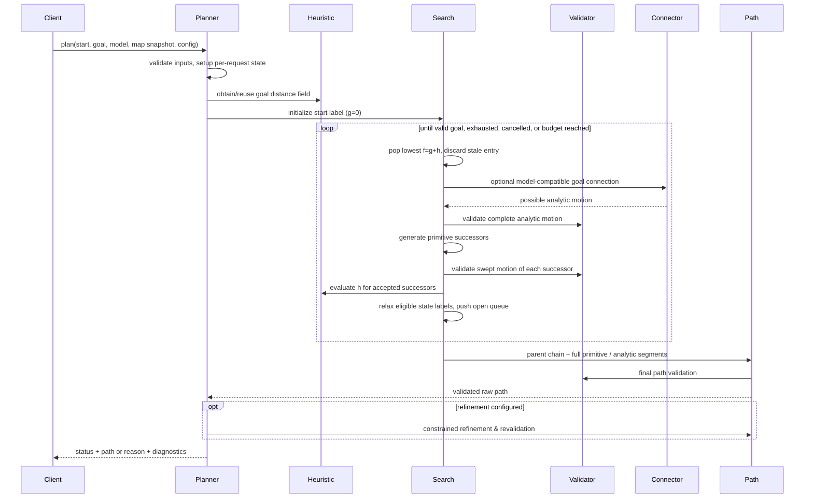

# Algorithms and invariants — draft v0.1

These are **behavioral specifications**, not proof of completeness, optimality, or hard real-time guarantees. The baseline deliberately retains **one continuous node per model-specific discretized key** (ADR-0013); exact tie-breaking, numeric precision and sampling/certification require review.

## Hybrid A* request flow



## Core search pseudocode

```text
validate request/map/model/start/goal and ensure the same planning frame
initialize or fetch model-specific primitive catalog and heuristic cache
check full start state validity/collision and validate goal-region specification
# a nominal goal-center pose can collide while valid end configurations exist within tolerance
insert start node: continuous state, model-specific discrete key, g=0, parent=none
while open not empty:
    if cancellation or budget reached: return explicit failure
    pop best f; skip stale labels
    if goal condition met: record valid candidate / apply termination policy
    optionally try analytic connector:
        if model-valid and entire motion collision-free:
            evaluate its actual configured cost; record candidate
    for each primitive candidate from current model state:
        propagate complete motion and intermediate states
        reject invalid controls, infeasible states, or swept collisions
        compute successor key and edge cost (must be nonnegative)
        relax the one retained continuous node per model-specific discrete key
        # incoming primitive affects transition effort but is not key by default
        compute heuristic (or pending lazy field completion)
        enqueue eligible successor
    terminate only when stopping rule justifies chosen quality guarantee
reconstruct exact state/control segments from stable parent records
validate reconstructed trajectory against request's map/model
optionally refine, accepting only separately validated result
return status, path and diagnostics
```

### Default goal acceptance (OQ-008, ADR-0016)

Accept only validated **continuous** candidate endpoints satisfying both `hypot(x-x_goal,y-y_goal) <= 0.25 m` and `abs(wrap(yaw-yaw_goal)) <= 10°`, with independently configurable thresholds (including zero). A caller may add model-specific state constraints; all unspecified joint/configuration variables remain free but must be valid. Do not accept by key alone or snap to the nominal goal center. The objective heuristic must target the **whole goal region**.

### Critical search invariants

- `g` represents the cost of actual accepted transitions; always nonnegative and finite. In-place rotations have **positive cost** even with zero translation.
- Parent/action records reconstruct the *exact* accepted motion (not straight lines between discretized cell centers).
- **OQ-001 / ADR-0013:** use one retained continuous node per discretized key; preserve incoming primitive, parent and `g`. Different continuous arrivals or incoming primitive histories can be merged, so lowest-`g` replacement is approximate and may lose feasible or lower-cost continuations. Multi-label machinery is deferred. Correct stale-entry handling and documented reopening/termination remain necessary.
- A popped node is not automatically globally optimal even with an admissible heuristic, since the quantized key may merge nonequivalent continuous states. Inconsistent/weighted heuristics add separate limitations. Reopening/termination assumptions must be explicit.
- Analytic expansion cannot bypass feasibility or collision checks. First-found analytic connection may be suboptimal; do not assert optimality without a justified termination rule.
- The discretized search may lose reachability at finite resolution; report actual guarantees, not idealized continuous-space completeness.

## Obstacle-aware heuristic

1. Use immutable static grid and a **goal-rooted, nonnegative-weight reverse graph search** (Dijkstra); do not just run point-to-point A*. World/grid conversion uses inverse SE(2) origin transform and X-fastest row-major memory order as specified in [map-coordinates.md](map-coordinates.md).
2. Optionally lazy-expand until the queried cell is **settled**; incomplete frontier values cannot be returned as final distances.
3. Use compact contiguous 2D storage for distances and visited/settled state; permit cache reuse only with matching map version, frame, **origin position/yaw**, resolution, dimensions, goal index, occupancy/unknown policy, and algorithm settings.
4. **OQ-005 / ADR-0015:** the default uses certified cost-to-**goal-region** lower bounds only; if both obstacle-aware and kinematic heuristics are certified in the configured cost units, `h=max(h_obstacle,h_kinematic)` is admissible. `h=0` is a valid fallback for nonnegative costs. Optional weighted/experimental search modes must be explicitly requested and report weakened guarantees.
5. **Admissibility caveat:** a grid's 4-/8-connected shortest-path cost is generally an *upper* approximation to shortest unconstrained continuous distance; conservative edge graph definitions/inflation and boundary offsets must be proved safe before claiming an admissible bound. Heuristic mode and guarantee metadata must expose this.
6. Treat unreachable (infinite) heuristic cells carefully: map-level disconnection can prune safely only if the static relaxed map models traversability conservatively; otherwise retain search freedom.

## Kinematic steering and primitive integration

- Primitive providers generate model-specific **admissible controls** from the complete state; precompute local templates only for state-invariant models. Holonomic/nonholonomic classification metadata never substitutes for model validity checks.
- **OQ-007 / ADR-0014:** the initial Ackermann model uses continuous `(x,y,yaw)` state and fixed-curvature straight/left/right (optional intermediate) arcs for forward/reverse motion. The model's controlled differential equation is the source of truth; a separate integration strategy produces full intermediate state trajectories. Exact circular arcs are preferred for baseline Ackermann; RK4 or another validated integrator serves more complex equations. Finite steering-rate/continuous steering at arc boundaries is **not** guaranteed by raw geometric propagation and must be checked before asserting it.
- Differential-drive in-place rotations must be modeled and collision-checked for full swept angular motion. Ideal mecanum must also support sideways translation with unchanged yaw and simultaneous translation/rotation without treating yaw as the tangent heading.
- Native Dubins (forward-only, bounded curvature) and Reeds–Shepp (forward/reverse, bounded curvature) are separate optional connectors. Reversing cusps preserve gear transitions. No steering-rate or articulation assumption is silently inferred.
- Numeric cost terms (reverse, kinematic effort, steering changes, clearance) must remain consistent across normal primitives, analytic expansions and lower-bound heuristics. Incoming primitive may affect transition costs without entering the baseline key, an acknowledged approximation rather than a valid exact dominance relation.

## Swept collision checking

Check every robot body `T_i(q) P_i` across the transition. Broad phase may use conservative bounding circles/AABBs/distance bounds; narrow phase uses transformed convex shapes. Adaptive sampling must consider maximum displacement of **any** body point due to translation, rotation and articulation, not just reference-point distance. Sampled validity is approximate; continuous guarantees require conservative interpolation bounds or continuous collision detection and must be identified separately in results.

## Reconstruction, refinement and output

- Follow stable node parent indices back to start; reverse sequence, append any validated analytic connection, reconstruct intermediate model states.
- Keep exact original motion path, including cusp and rotate-in-place events and its start/end conditions.
- Optional shortcutting or curve optimization only accepts replacements with verified endpoints, model constraints, collision clearance and cost policy.
- For clamped spatial curves, endpoint heading can be constrained through endpoint tangents, but curvature, curvature rate and articulated feasibility require extra constraints; a smooth spline is **not** automatically feasible.
- Output is a piecewise path with monotone progress, independently evaluable segments and full model-state semantics. Holonomic travel direction and body yaw may differ. The separate MPC owns final timing, speeds, acceleration and moving-obstacle prediction; rate-limited path claims must state the timing assumptions on which they rely.
