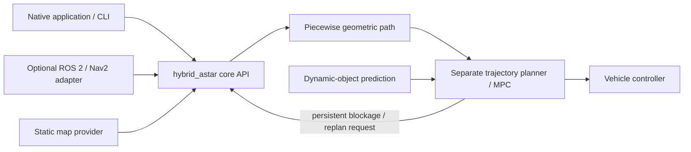
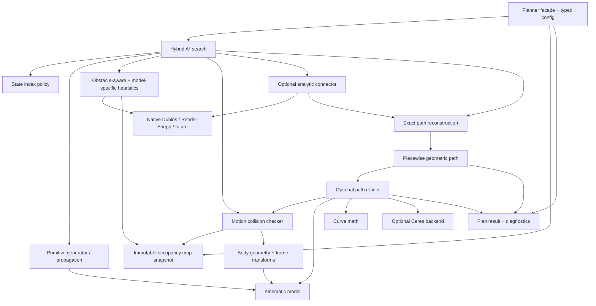

# Components and dependency boundaries — draft v0.1

The library is **not** one object hierarchy. The search kernel is a compile-time, policy-driven orchestrator. Data types at public boundaries are value-oriented; runtime adapters can type-erase implementations where useful. The kinematic model supplies a controlled ODE and admissible controls; motion integration is a separate concern ([kinematic contract](kinematic-models.md)).

## System context



The core accepts a consistent **static map snapshot**. Dynamic-obstacle predictions are not part of the Hybrid A* request. It is a separate planner/controller responsibility to choose a safe time-dependent trajectory.

## Internal component view



Arrows mean *uses*. Diagram is logical; no requirement that every box maps to a separately linked library.

## Responsibilities and ownership

| Component | Owns / provides | Explicitly does not own |
| --- | --- | --- |
| Planner facade | Request validation, setup, cancellation, result and diagnostics | ROS messages, map streaming, MPC |
| Search engine | Node pool, open queue, g-values, parent links, iteration/budget policy | Vehicle equations, collision geometry, YAML/JSON |
| Kinematic model | State/control/tangent types, controlled vector field, admissible constraints, world pose and named body-frame transforms | Search bookkeeping, numerical integration algorithm |
| Integrator | RK4 baseline numerical propagation primarily for primitive *generation*, respecting state topology; accumulated traveled-length termination, validated endpoints and ordered full-state samples (ADR-0023) | Primitive selection, map queries or per-node search bookkeeping |
| Primitive generator | Candidate admissible controls, geometric extents, generated RK4 trajectories/control-law evaluators and stored samples; cache truly reusable SE(2)-relative templates and regenerate/cache by internal state when required (ADR-0023) | Global map or cost policy |
| State index policy | Quantized complete state, key hash/equality, dominance scope | Continuous propagation |
| Steering connector | Analytic feasible connections when assumptions apply | Map obstacle testing, global optimization |
| Obstacle heuristic | Static map goal-distance cache, lazy reverse graph expansion | Vehicle shape and dynamics |
| Collision checker | State/motion swept-footprint validation against snapshot | State transition selection or global heuristic |
| Robot geometry | Immutable shapes, local frame attachment and margins | Actual state estimation/TF lookup |
| Reconstruction | Reverse parent chain; piecewise exact primitives and analytic segments | Curve fitting |
| Refinement | Shortcut/fitting/optimization, feasibility certification and rollback | Search node ownership |
| Geometric path | Evaluating validated ordered segments and progress semantics | Time-parameterized robot commands |
| Serialization adapters | yaml-cpp / nlohmann/json typed config and result conversion | Hot-path algorithms |
| Optional ROS adapter | TF2, lifecycle, nav messages and plugin glue | Internal vehicle model propagation |

## Compile-time dependency rules

- `math` and foundational value types depend only on standard C++ (Eigen may be used behind an explicit target boundary).
- `kinematics` depends on shared types and math; never on search or ROS.
- `motion` depends on kinematics/math; model derivative and separate integrator are explicit contracts, and primitive caches are scoped to model configuration.
- `collision` depends on environment snapshots, geometry and model frame transforms; must never query TF2 during search. A ROS adapter resolves `map`, `odom` and `base_link` transforms before invoking the planner; mismatched frames are invalid.
- `heuristics` depends on environment and optional steering adapters, not on path refinement.
- `search` depends on model/primitive/index/heuristic/collision/connector *contracts*.
- `path` and `refinement` depend on shared model/geometry/validation; Ceres is a private, optional refinement dependency.
- `adapters` depend inward on public core APIs, never vice versa.

## Lifetime, mutability, and concurrency

- `MapSnapshot` is immutable and versioned during a planning request. Its frame, origin SE(2), X-fastest row-major layout and occupancy **encoding** follow the [ROS-compatible map convention](map-coordinates.md). The **interpretation policy** is request-specific (unknown default `Occupied`, known maximum traversable occupancy default `0`, ADRs 0017–0018). The producer may concurrently publish a *different* snapshot without mutating the one in use. **Accepted ADR-0019:** publish a privately built immutable whole-grid `shared_ptr<const MapData>` via atomic latest-snapshot handoff; each request pins its revision and model/map metadata. Start with whole-grid copies at publication, tile/COW only if measured necessary ([ADR-0019](../adr/0019-live-map-snapshot-cache-and-reject.md)).
- Model configuration, collision shape definitions, primitive catalogs, and steering solver parameters are immutable within a request. Capability metadata does not supersede model-specific state-dependent admissible control checks.
- The simplest initial policy is **one active `plan()` per planner instance**; this is proposed, not yet accepted. Concurrent requests can use distinct instances sharing immutable resources.
- Scratch pools and open/closed state belong to an individual request/instance; neither are shared unsafely.
- **Accepted ADR-0019:** key obstacle-distance and other map-derived caches by all effective dependencies: map identity/revision (grid geometry/frame/encoding), occupancy threshold/unknown policy, goal *region* discretization, relevant inflation and heuristic configuration. Reuse exactly compatible fields or build **on demand**; bounded cache retention/eviction, preserve pinned old entries; no incremental repair initially. Cache-sharing/synchronization between concurrent planner instances remains OQ-012; settled-distance and heuristic-admissibility rules still apply.
- Abort/cancel/budget exhaustion produce an explicit result status, not an invalidated successful path.

## Initial layout (proposed)

```text
include/hybrid_astar/{core,math,kinematics,motion,environment,collision,heuristics,steering,path,refinement}
src/{core,math,kinematics,motion,environment,collision,heuristics,steering,path,refinement}
adapters/{yaml,json,ros2}
tests/{contracts,kinematics,motion,steering,heuristics,collision,search,path}
benchmarks/
examples/
docs/{architecture,adr}
```

This is a module map, not a mandate for one class/file per name. Refer to [interfaces.md](interfaces.md) before concrete header design.
